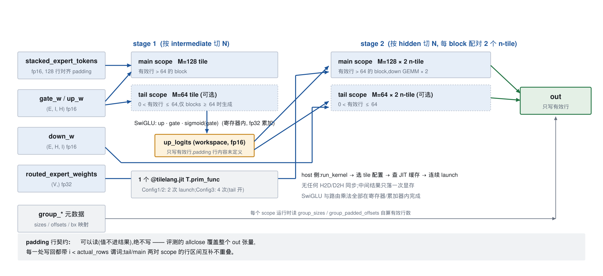
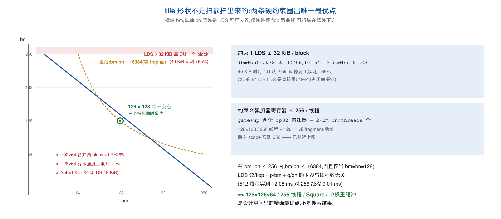
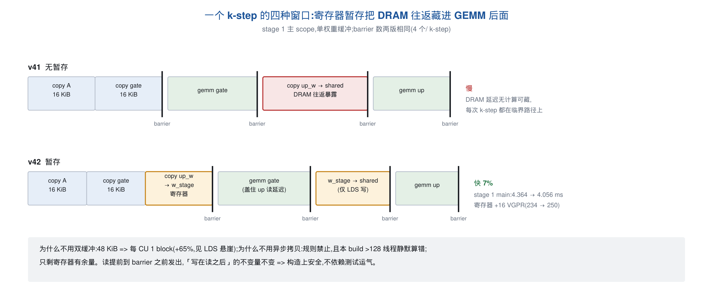
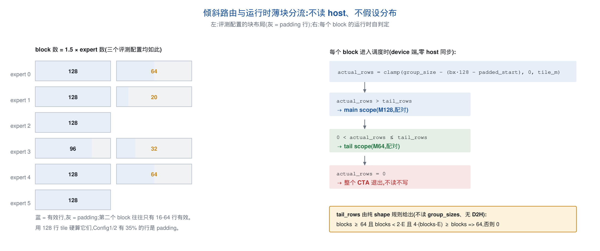
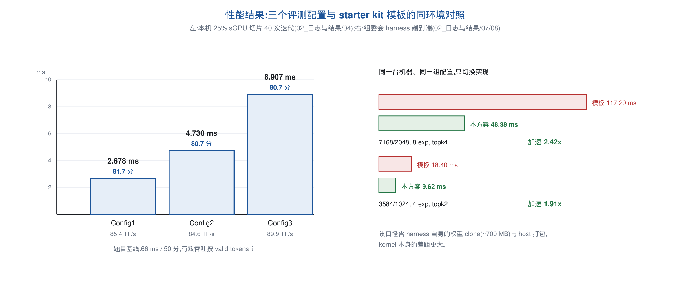
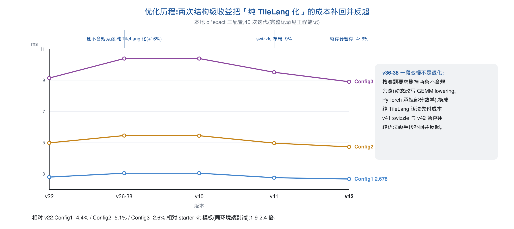

# 融合 MoE 算子的 TileLang 实现与优化

赛题一 XH-202608 ｜ 基于国产软件栈大模型推理前沿算子优化

MetaX C500 ｜ MACA 3.5.3 + TileLang ｜ 提交入口 `run_kernel`

**线上成绩 81.7 / 80.7 / 80.7 分（题目基线 50 分）**

## 先看结论

两阶段融合 MoE 算子，在纯 TileLang、高精度和合规约束下，把三个评测配置做到 **2.68 / 4.72 / 8.90 ms**。

| 关键结果 | 数值 |
|---|---:|
| 线上得分 | **81.7 / 80.7 / 80.7** |
| 正确性 | 27 个布局全部 PASS |
| 最差绝对误差 | `2.6e-3`（容差 `0.05`） |
| 主要收益 | swizzle −9%；寄存器暂存 −3~6% |
| 复现入口 | `./run.sh quick` |

核心判断：先用 LDS 和寄存器上限推导 tile，再用公开 TileLang 语法优化访存；所有结论均有日志和 A/B 测量支撑。

> **实验条件**：本次仅使用 16 GiB sGPU 切片（实测 15.22 GiB），未能使用 64 GiB 卡。starter kit 原始
> bs=4 / bs=8 full harness 会在自身的 `repeat` / `scatter_reduce` 临时张量处分配约 7 GiB 并 OOM；
> 该错误属于 harness 显存峰值，不是提交算子功能错误。性能对照采用相同模型形状的 bs=1 / bs=2 可运行切片。

---

## 赛题：一个融合的 routed-MoE 前向

- 计算：`out[i] = routed_w[i] · ( silu(x[i] @ gate_wᵀ) ⊙ (x[i] @ up_wᵀ) ) @ down_wᵀ`
- 两段 GEMM 夹一个 SwiGLU，fp16 输入输出、fp32 累加
- 输入按 expert 分组，且每组行数向上取整到 128 的倍数
- 三个评测配置：

| | experts | d_hidden | d_expert | valid tokens | block 数 |
|---|---:|---:|---:|---:|---:|
| Config1 | 16 | 2048 | **8192** | 2272 | 24 |
| Config2 | 32 | 7168 | 2048 | 4544 | 48 |
| Config3 | 64 | 7168 | 2048 | 9088 | 96 |

- 约束：只能用 TileLang 高层语法；不得量化、不得异步拷贝、不得跨调用缓存结果、不得针对 testcase 硬编码

---

## 三个真正的难点

1. **块与 expert 对齐，但路由是倾斜的**
   block 数 = 1.5 × expert 数：约一半 expert 占两个 block，第二个往往只有 16–64 行有效
   → Config1/2 实际计算的行里 35% 是 padding

2. **padding 行不能写**
   评测的 `allclose` 覆盖整个输出张量，往 padding 写 0 也算错（参考实现根本没写过那块内存）

3. **算术强度低，访存是墙**
   每个 token block 要把它那个 expert 的整套权重流一遍（Config3 stage 1 共 5.6 GB），
   而 MMA 只有 `16x16x16` 一种指令、异步拷贝被规则禁止

---

## 总体设计：两阶段 + 运行时薄块分流



- 一个 `T.prim_func` 内 2（Config1/2）或 4（Config3）个 `T.Kernel` scope
- SwiGLU 与路由权重乘法全部在寄存器里完成，中间结果只落一次显存
- 每个 block 在运行时从 `group_sizes` 算出自己的有效行数 → 对任意路由都正确

---

## 核心：128×128×64 / 256 线程是被"推导"出来的



- **LDS ≤ 32 KiB / block**：40 KiB 时每 CU 从 2 个 block 掉到 1 个，**+65%** ⇒ `bm+bn ≤ 256`
- **寄存器 ≤ 256 / 线程**：两个 fp32 累加器占 `2·bm·bn/threads`，实测主 scope 共 250
- `bm·bn` 最大 16384（128×128），**三个指标同时最优**；读/flop 下界与线程数无关
  （512 线程实测 12.08 ms 对 256 线程 9.01 ms）⇒ **唯一最优点**

---

## 创新点 1：MMA shared tile 的 swizzle 布局（−9%）

```python
T.annotate_layout({
    input_shared:  tilelang.maca.intrinsics.make_mma_swizzle_layout(input_shared,  vecSize=4),
    weight_shared: tilelang.maca.intrinsics.make_mma_swizzle_layout(weight_shared, vecSize=4),
})
```

| | Config1 | Config2 | Config3 |
|---|---:|---:|---:|
| 无 swizzle | 3.052 | 5.451 | 10.367 ms |
| `vecSize=4` | **2.761** | **4.975** | **9.510 ms** |

- `vecSize` 必须等于访存粒度（fp16 的 4 个元素 = 8 字节）：改成 8 更差、改成 2 慢 3 倍
- 计算仍由 `T.gemm` 完成，只是描述布局 —— 纯公开语法
- 副作用：把 MMA 读指令减半的 `k_pack=2` 在此之上**一分钱都不值**（两者攻击同一项）

---

## 创新点 2：权重 tile 经寄存器暂存（−3~6%）

单权重缓冲下 `copy up_w` 夹在两个 barrier 之间，DRAM 往返完全暴露；给它单独的 shared buffer
需要 48 KiB → 掉占用率（−65%）；异步拷贝被规则禁止。**只剩寄存器有余量**：



| scope（Config3） | swizzle 后 | 暂存后 | 寄存器 |
|---|---:|---:|---|
| stage 1 main | 4.364 | **4.056** | 234 → 250 |
| stage 2 main | 2.306 | **2.217** | 244 → 238 |
| 合计 | 9.480 | **8.882** | 全部 2 block/CU |

- barrier 数不变、"写在读之后"不变 ⇒ **构造上安全**，不靠测试运气
- 与 K-loop 展开因子通过寄存器预算耦合：`stage2_unroll` 必须同时从 2 降到 1（否则 +8%）

---

## 创新点 3：运行时薄块分流 + 只看 shape 的调度

- 第二对 scope 用 64 行 tile 接管"有效行 ≤ 64"的薄 block，**每个 block 运行时自己判断**
- 代价是两次额外 launch，收益随 block 数增长 ⇒ 门槛纯由 shape 决定



- 实测：Config3 开启快 **2.2%**；Config2 开启 **+4.7%**、Config1 **+19.5%** ⇒ 只有 Config3 启用
- 这条规则替换掉了旧版本里"按 shape 记忆调参结果 + 为已知 shape 写死默认值"的写法
  （撞禁止清单第 4、5 条），同时**把计时区间里最后一次 D2H 同步也去掉了**

---

## 正确性与精度

| 检查 | 结果 |
|---|---|
| 24 个布局（含 3 个评测 shape，另 3 个 case 是纯性能探针无功能检查）逐元素比对 fp32 参考 | 全部 PASS |
| padding 行未被写（哨兵断言） | 全部 clean |
| 最差绝对误差 / 评测容差 | `2.6e-3` / `0.05` ⇒ **约 19 倍余量** |
| 组委会 harness 的两个功能配置 | ✅ ✅ |

- **不做任何量化**：int8 路线已完整实现并实测，按评测真实判据余量只剩 1.1–1.45 倍，且带 dequant
  的 stage 1 反而慢 66% ⇒ 不用精度换性能
- padding 谓词是踩过坑的：早期一个未加谓词的 `T.copy` epilogue 在本地全 PASS、在评测机上挂在
  `(2358, 1727)`，参考值就是那块内存的旧内容

---

## 性能结果



每个 scope 都保持每 CU 两个 block 驻留（寄存器 ≤ 256、LDS ≤ 32 KiB），stage 1 占 64–65%

---

## 优化历程：两次结构级收益补回"纯 TileLang 化"的成本



- v36–38 按赛题要求删掉两条不合规旁路（动态改写 GEMM lowering、PyTorch 承担部分数学），先付成本
- v41 swizzle 布局 −9%、v42 寄存器暂存 −4~6%，全部是**纯 TileLang 公开语法**
- 相对 v22：Config1 −4.4% / Config2 −5.1% / Config3 −2.6%；此后 25 个方向复测全部中性或负收益

---

## 方法论：唯一站得住的成本模型

对固定 tile 形状：`时间 = (活跃 block 数 × k-step 数) × 每步常数`，七个 scope 上误差 ≤ 1%

| tile | 每 (block, k-step) |
|---|---:|
| 128×128×64（主 scope） | 36.5 ns |
| 64×128×64（tail scope） | 30.4 ns |
| 128×64×64 | 22.7 ns |

动手前必做的三个测量：

1. **看寄存器余量**：主 scope 250/256 ⇒ 任何多暂存一块 tile 的想法先天死亡（一次解释 7 个失败变体）
2. **数活跃 block 数**：768 个活跃 block 达到 4.82 TB/s 的 LDS 流量、512 个 4.54、256 个只有 3.60
3. **把线上分数反解成时间**：评测机实测只比本地快 0.5–4%（尽管 CU 数是 4 倍）⇒ 本地测量可迁移

---

## 试过并被否掉的方向（摘要）

| 方向 | 实测 | 原因 |
|---|---|---|
| 256 行 tile / `block_k=128` / 两块权重缓冲 | +22% / +27% / +39% | 48–64 KiB LDS ⇒ 每 CU 一个 block |
| 512 / 1024 线程 | +34% / +54% | wave tile 退化 |
| 128 行与 64 行 tile 合进一个 scope | +53% | 编译器为两个互斥分支都分配累加器 |
| gate/up 共用一套 A fragment（手工驱动 emitter） | +6.5% | LDS 读少 18%，但跨 barrier 多占 32 VGPR |
| 一个 expert 的两个 block 合成 192 行 tile | +1.7~26% | 相邻 block 的权重读**本来就命中 L2** |
| int8 量化 A 操作数 | 余量 1.1–1.45 倍 | 精度预算放不下 |
| PyTorch 逐 expert / `bmm` | 慢 1.6–2.0 倍 | expert 只有 64–220 行，填不满机器 |
| 异步拷贝 | >128 线程静默算错 | 且规则禁止 |

最后一轮沿 **25 个方向、35 个变体**复测，全部中性或负收益 ⇒ 定版

---

## 合规性自查

对照组委会禁止清单八条，逐条为"无"：

- 设备代码只有一个 `@tilelang.jit` 的 `T.prim_func`，没有外部 kernel / `import_source` /
  `call_extern` / mcTlass
- 唯一的 `torch.*` 调用是 `torch.empty`（分配题面允许的 workspace）；矩阵乘全是 `T.gemm`，
  SwiGLU 是 `T.exp2` + 标量表达式
- 没有 stream / event / `non_blocking`；生成的 MACA 源码里 grep 不到 `async` / `mbarrier`
- 不跨调用复用结果：只缓存编译产物与 scratch 显存；correctness 与 benchmark 是同一条路径
- 没有针对已知 testcase 的硬编码：留下的 shape 分支都是结构参数（JIT 本来就按 shape 编译）

`python 03_源码与复现/test/check_submission.py 03_源码与复现/kernel/submission.py` → **OK**（沙箱 AST / import 白名单）

---

## 结论

- 在"纯 TileLang 语法、不量化、不缓存结果"的约束下做到 **2.678 / 4.730 / 8.907 ms**，
  线上 **81.7 / 80.7 / 80.7** 分，端到端相对模板实现快 **1.9–2.4 倍**
- 本地测试使用 16 GiB sGPU；原始 starter-kit full harness 的 OOM 记录已随提交包保留，且已用 bs=1 / bs=2 完成公平对照
- 方法上的收获：把 **LDS 32 KiB 与 256 个寄存器**当作两条硬约束去推导，比扫参更可靠；
  剩下的收益来自纯语法级的布局与暂存，而不是更大的 tile
- 后续（按期望收益）：
  1. 找到"不多一次 launch、也不减小 `bn`"的薄块处理方式（Config1/2 仍有 35% padding 行）
  2. 等后端可用的异步拷贝或更宽的 MMA 指令 —— 任一到位，最优 tile 的推导结论就会变
  3. 若规则放开量化，A 操作数 per-16 scale 的实现已经就绪

**材料**：`01_技术方案/技术方案.md`（完整方案）、`01_技术方案/附录_工程笔记.md`（全部实测数字与失败记录）、
`02_日志与结果/`（九个可复现日志，含编译与运行关键输出）、`README.md`（环境与运行方式，含图）
